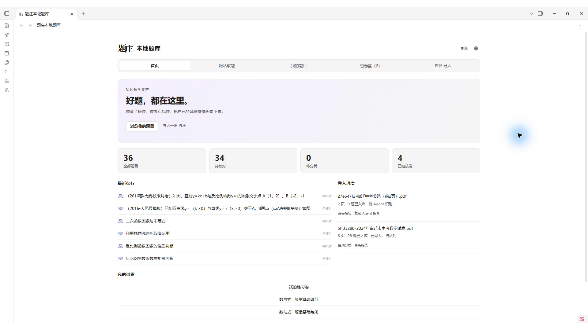
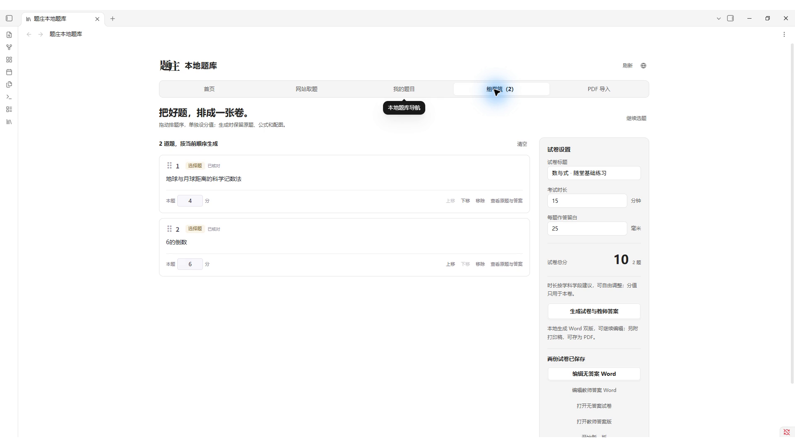
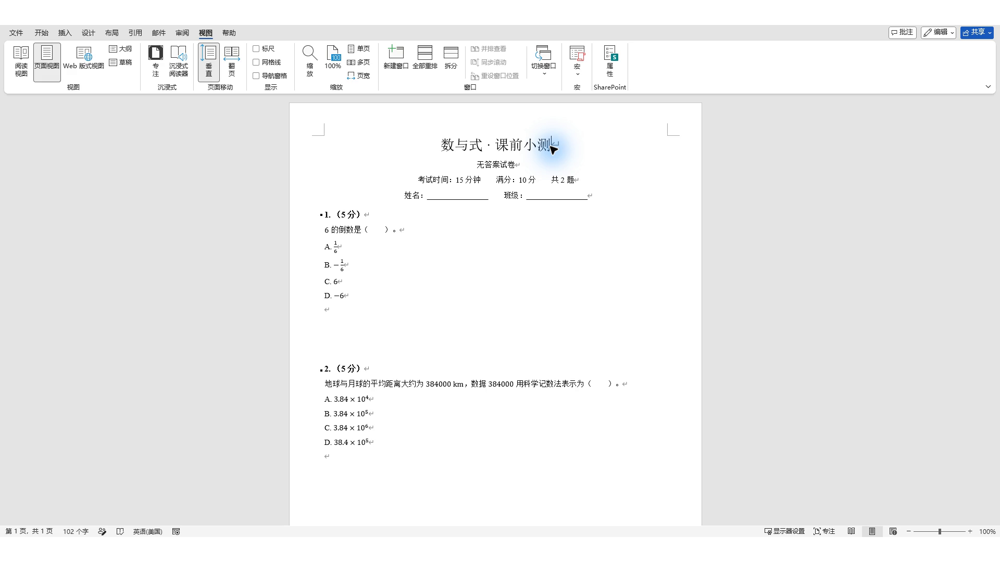

<p align="center"></p>

<p align="center">
  <a href="https://tizhuang.qcscience.cc/">题庄官网</a> ·
  <a href="https://tizhuang.qcscience.cc/builder">在线组卷</a> ·
  <a href="https://tizhuang.qcscience.cc/pricing">免费额度与合作</a>
</p>

## 你需要哪一个？

**缺合适的题，用在线题库；想把好题积累下来，用本地题库。** 两个 Skill 独立安装，不需要先装另一个。这个仓库是统一入口，详细教程放在各自文档中。

<table>
<tr>
<td width="50%" valign="top">
<h3>01 · 题庄在线题库</h3>
<p><strong>说出备课要求，让 Agent 帮你找真题。</strong></p>
<a href="docs/question-bank/README.md"></a>
<p>适合备课找题、单元复习、专题训练和课堂测验。</p>
<ul>
<li><strong>按条件找题</strong>：学科、教材、章节、知识点、题型和难度。</li>
<li><strong>保留原题</strong>：题干、公式、配图、答案与解析。</li>
<li><strong>接着组卷</strong>：生成练习，在网站继续编辑、分享与打印。</li>
</ul>
<p><strong>1.0.3</strong> · 更新于 2026-10-18</p>
<p><a href="docs/question-bank/README.md"><strong>介绍与安装 →</strong></a> · <a href="docs/question-bank/客户端安装.md">客户端安装方式</a> · <a href="docs/question-bank/CHANGELOG.md">更新记录</a></p>
</td>
<td width="50%" valign="top">
<h3>02 · 题庄本地题库</h3>
<p><strong>用过的好题，下次还找得到。</strong></p>
<a href="docs/local-bank/README.md"></a>
<p>适合老师整理 PDF 试卷、沉淀教学题库和反复组卷。</p>
<ul>
<li><strong>题目留在本地</strong>：网站取题或由 Agent 整理 PDF 入库。</li>
<li><strong>按树和标签找题</strong>：知识点分类、检索、核对与复用。</li>
<li><strong>可视化组卷</strong>：调整题序与分值，导出学生卷和教师答案 Word。</li>
</ul>
<p><strong>Skill 1.0.0 · 插件 1.0.0</strong> · 更新于 2026-10-18</p>
<p><a href="docs/local-bank/README.md"><strong>介绍与安装 →</strong></a> · <a href="docs/local-bank/USER_GUIDE.md">图文教程</a> · <a href="downloads/local-bank/v1.0.0/tizhuang-local-bank-starter-v1.0.0.zip">下载起步包</a></p>
</td>
</tr>
</table>

> 截图来自实际网站与 Obsidian 演示题库，空白起步包不预装这些题目。[截图来源与版本说明](assets/skill-family/截图来源.md)

## 从找到一道题，到留下一份好试卷

| 在线找题 | 本地积累 | 再次使用 |
| :--- | :--- | :--- |
| 告诉 Agent 教材、章节与要求，返回真实题目。 | 保存网站好题，或把自己的 PDF 整理成可编辑题目。 | 按知识点检索，核对后组卷，导出可编辑 Word。 |

<details>
<summary><strong>看看本地组卷与 Word 的实际效果</strong></summary>
<p></p>
<p></p>
</details>

## 开始使用

**在线题库** · 在支持 Skill 的客户端安装：

```bash
npx skills add weishao2/tizhuang-agent-skills --skill question-bank
```

**本地题库** · 把下面这句话交给能读写本地文件的 Agent：

> 请按 https://raw.githubusercontent.com/weishao2/tizhuang-agent-skills/main/docs/local-bank/INSTALL.md 帮我安装题庄本地题库。检查环境，安装 Skill 和 Obsidian 插件，创建空白题库；保留已有题目与配置，不改在线题库 Skill。安装后运行环境体检。

[直接下载空白题库＋插件＋Skill](downloads/local-bank/v1.0.0/tizhuang-local-bank-starter-v1.0.0.zip) · [详细安装步骤](docs/local-bank/INSTALL.md)

普通用户可免费开始，网站取题按账户额度计算；本地保存和组卷不重复扣取题额度。PDF 识别需要具备文件与图像处理能力的 Agent，正式使用前由老师核对；第三方 Agent 或模型可能另行收费。

<details>
<summary>开发者：源码与目录</summary>

```text
skills/question-bank/          在线题库 Skill
skills/tizhuang-local-bank/    本地题库 Skill
plugins/obsidian/              本地题库的 Obsidian 插件
docs/                        各技能介绍、安装与教程
downloads/local-bank/        空白起步包
```

</details>

Skill 适配器源码使用 [MIT License](LICENSE)；ClawHub 上架版本按该平台要求以 MIT-0 发布。题库内容及在线服务适用各自的服务规则。
