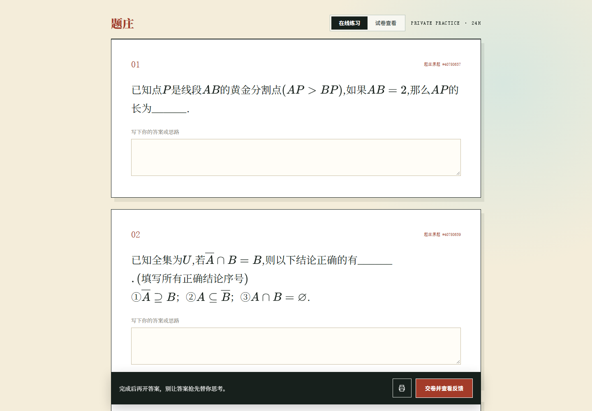
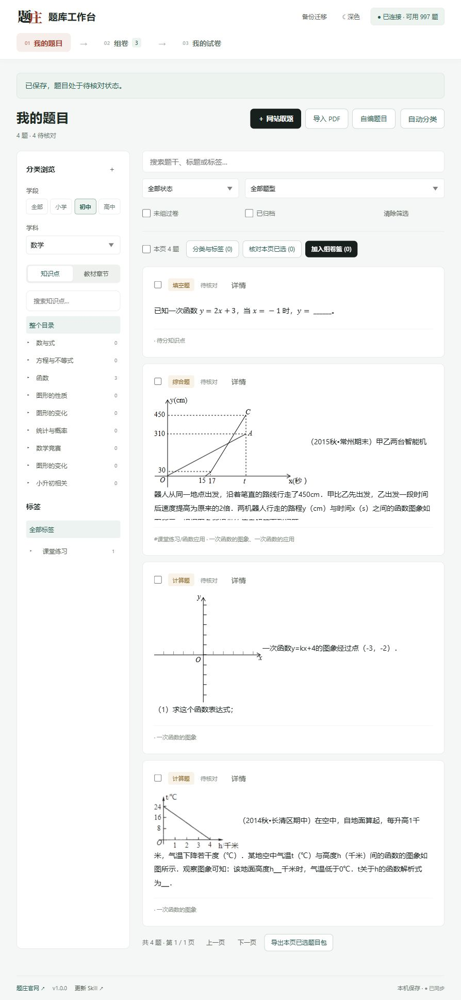
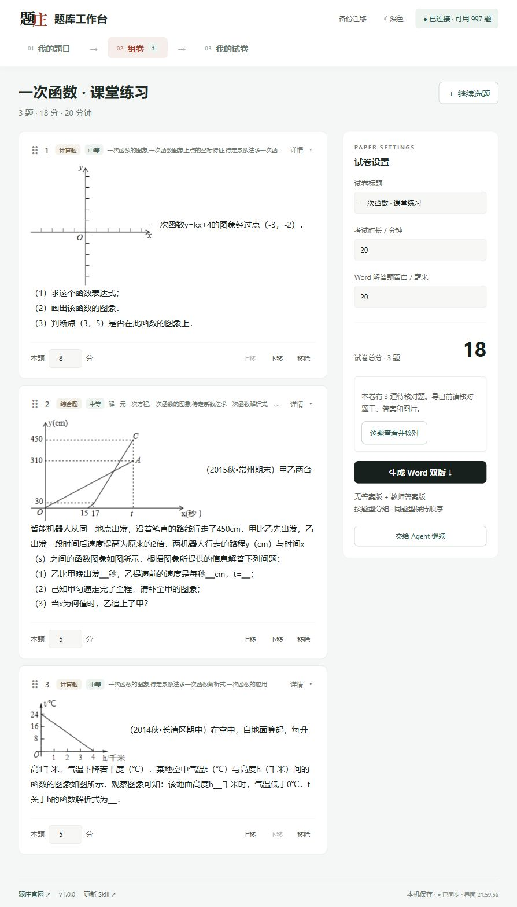

<p align="center"></p>

<p align="center"><a href="https://tizhuang.qcscience.cc/">题庄官网</a> · <a href="https://tizhuang.qcscience.cc/builder">在线组卷</a> · <a href="https://tizhuang.qcscience.cc/pricing">免费额度与合作</a></p>

**缺合适的题，用在线题库；想把好题积累下来，用题库工作台。** 两个技能独立安装。这里是统一目录，各自的安装和教程都在下面。

<table><tr><td width="50%" valign="top">
<h3>01 · 在线题库</h3>
<p><strong>说出要求，让 Agent 找真题。</strong></p>
<a href="docs/question-bank/README.md"></a>
<ul><li>按学段、学科、知识点或教材章节找题。</li><li>保留题干、公式、配图、原答案与解析。</li><li>接着在网站组卷、分享与打印。</li></ul>
<p><code>question-bank</code> · <strong>1.0.3</strong> · 2026-10-18</p>
<p><a href="docs/question-bank/README.md">介绍与安装 →</a> · <a href="https://tizhuang.qcscience.cc/skills/question-bank">官网详情</a></p>
</td><td width="50%" valign="top">
<h3>02 · 题库工作台</h3>
<p><strong>好题留下来，备课接着用。</strong></p>
<a href="skills/tizhuang-studio/README.md"></a>
<ul><li>网站取题、PDF 导入、自编题，保存到自己的电脑。</li><li>知识点树、教材章节、标签和搜索，题目反复复用。</li><li>Agent 与页面共用组卷篮，调序改分，导出 Word 双版。</li></ul>
<p><code>tizhuang-studio</code> · <strong>1.0.0</strong> · 2026-11-08 · 无需 Obsidian</p>
<p><a href="docs/studio/INSTALL.md">介绍与安装 →</a> · <a href="docs/studio/USER_GUIDE.md">使用教程</a> · <a href="https://tizhuang.qcscience.cc/skills/tizhuang-studio">官网详情</a></p>
</td></tr></table>

## 开始使用

**在线题库**，在支持 Skill 的客户端安装：

```bash
npx skills add weishao2/tizhuang-agent-skills --skill question-bank
```

**题库工作台**，复制给能操作本机文件的 Agent：

> 请按 https://tizhuang.qcscience.cc/studio/INSTALL.md 安装题庄题库工作台。没装就安装，旧版备份后更新，同版跳过，保留我的题目和配置。创建独立环境并体检，成功后打开工作台；两个旧 Skill 和 Obsidian 题库不要动。

[下载工作台完整程序包 v1.0.0](downloads/studio/v1.0.0/tizhuang-studio-v1.0.0.zip) · [安装与更新](docs/studio/INSTALL.md) · [更新记录](skills/tizhuang-studio/CHANGELOG.md)

程序包不附用户题库、Key 或演示题。初次启动创建空白工作区，Key 在页面连接。PDF 需具备图像能力的 Agent 识别，正式出卷前由老师核对。基础功能免费，网站取题按账户额度；第三方 Agent 或模型可能收费。

## 页面与 Agent，一份组卷篮



我的题目 → 组卷 → 我的试卷。页面选题，Agent 调整题序与分值；核对后导出学生卷、教师答案 Word 和打印稿。题目保存在本机，关闭浏览器后仍在；更换电脑可通过完整备份迁移。本版没有自动云同步。

截图来自真实网页与 2026-11-08 独立录像工作台；自编演示题明确标注来源，待核对截图不代表老师已确认。

## 历史版本

[Obsidian 题库 tizhuang-local-bank](docs/local-bank/README.md) 已停止功能更新，原安装包、插件源码与使用说明保留。工作台独立安装，不自动覆盖旧 Skill 或旧题库；支持导入旧版导出的 v1 题目包。

```text
skills/question-bank/       在线题库
skills/tizhuang-studio/     题库工作台（主推本地技能）
skills/tizhuang-local-bank/ Obsidian 历史版
plugins/obsidian/           历史插件源码
docs/                      各技能安装与教程
downloads/                 已校验的版本包
```

Skill 适配器源码使用 [MIT License](LICENSE)；题库内容及在线服务适用各自的服务规则。
