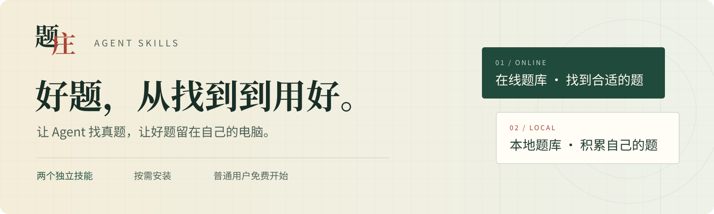

<p align="center"></p>

<p align="center"><a href="https://tizhuang.qcscience.cc/">题庄官网</a> · <a href="https://tizhuang.qcscience.cc/builder">在线组卷</a> · <a href="https://tizhuang.qcscience.cc/pricing">额度与合作</a></p>

## 在线题库

说出学段、学科、知识点或教材章节，让 Agent 找真实题目，保留题干、公式、配图、原答案与解析，接着在网站组卷、分享和打印。


`question-bank` · **1.0.3**

```bash
npx skills add weishao2/tizhuang-agent-skills --skill question-bank
```

[介绍与安装](docs/question-bank/README.md) · [官网详情](https://tizhuang.qcscience.cc/skills/question-bank)

## 历史版本

[Obsidian 题库](docs/local-bank/README.md) 保留原安装包、插件源码与使用说明。

题库工作台暂时下架，后续安排请关注题庄官网。

## 免费额度

未注册 Agent 50 题 / 24 小时。免费注册 150 题 / 天。前六次有效邀请依次增加 25、25、10、10、10、10 题 / 天，最高 240 题 / 天。实际剩余额度以账户为准。

Skill 适配器源码使用 [MIT License](LICENSE)。题库内容及在线服务适用各自的服务规则。
