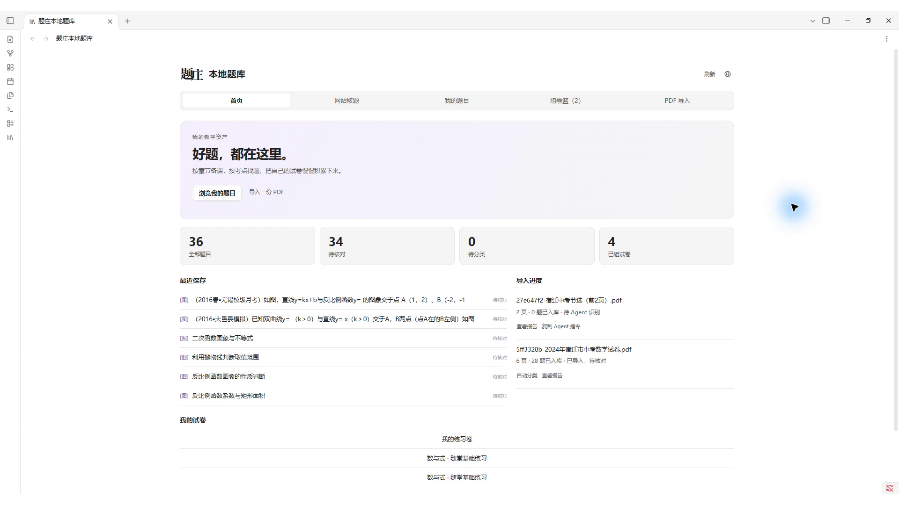
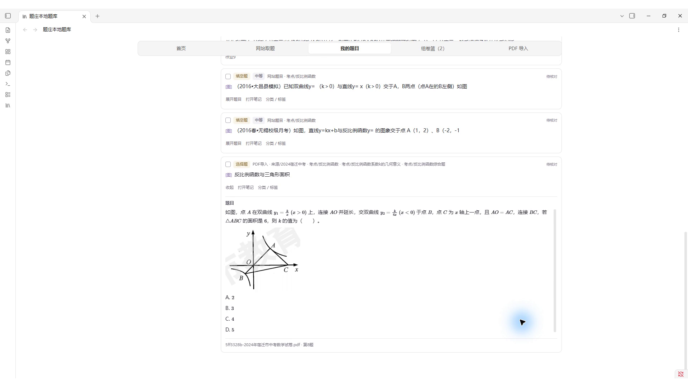
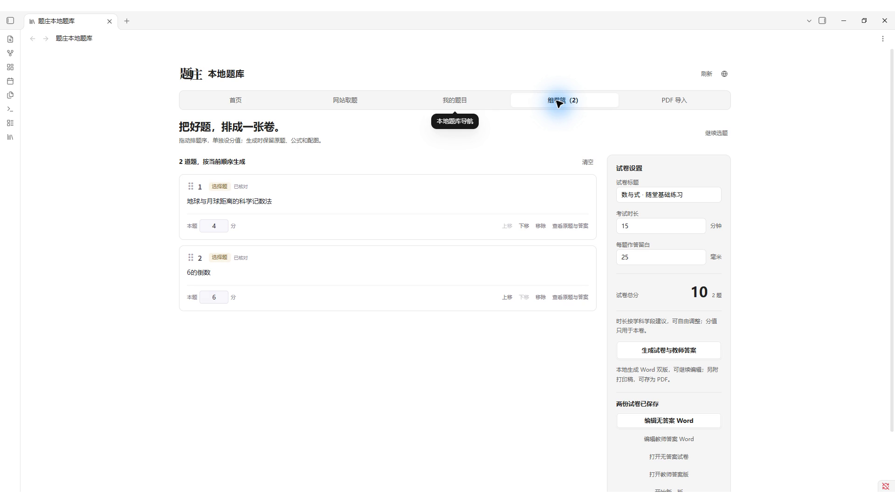
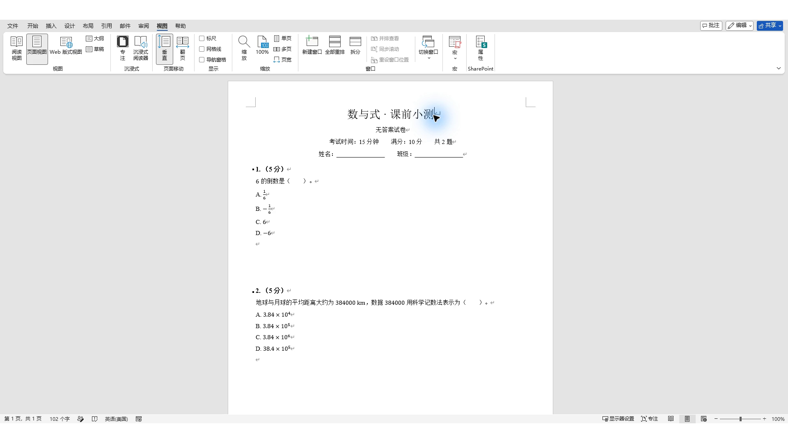

# 题庄本地题库

**用过的好题，下次还找得到。**

把网站题目与自己的 PDF 试卷整理到本地，按知识点树和标签找题，勾选组卷，输出可继续编辑的 Word。

[返回题庄技能目录](../../README.md) · [官网详情](https://tizhuang.qcscience.cc/skills/tizhuang-local-bank) · [完整图文教程](USER_GUIDE.md)

## 看看实际效果



*原生 Obsidian 实录。画面是已有演示题库，空白起步包不预装这些题目。*

### PDF 变成可以编辑的题目

Agent 查看原页、识别题干和答案，分别保存文字、公式与真实配图。导入后保持待核对，再由老师确认。



*已完成整理的真实示例，不表示点一次“导入”就自动完成所有识别和核对。*

### 从选题到 Word

本地勾选题目，调整顺序与分值，分别生成无答案试卷和教师答案版。





*上述图片来自 2026-10-14 原生 Obsidian 与 Microsoft Word 录屏；当前包版本见下方。*

## 三步开始

1. 准备电脑、Obsidian 和能访问本地文件的 Agent。
2. 把下面这段话交给 Agent，自动判断安装、更新或跳过，并检查环境。
3. 打开自己的题库，从下载知识树、放入几道题、核对、组卷开始。

> 请按 https://raw.githubusercontent.com/weishao2/tizhuang-agent-skills/main/docs/local-bank/INSTALL.md 帮我安装题庄本地题库。先检查已有题库、插件和新 skill；没装就安装，旧版就更新，同版或更新版本就跳过。保留我的题目、图片、试卷和全部原配置，旧 question-bank skill 不动。安装后运行环境体检。

首次启用 Obsidian 第三方插件需本人确认。更新保留已有题目、图片、试卷和配置。

- [完整起步包 1.0.1：空白题库＋插件＋Skill](../../downloads/local-bank/v1.0.1/tizhuang-local-bank-starter-v1.0.1.zip)
- [安装与更新细节](INSTALL.md)
- [老师图文使用教程](USER_GUIDE.md)

只想使用 Agent，可单独安装 Skill（不含 Obsidian 插件）：

```bash
npx skills add weishao2/tizhuang-agent-skills --skill tizhuang-local-bank
```

## 装好后试着这样说

```text
用 tizhuang-local-bank 从我的本地题库找 8 道已核对的一次函数题，基础和中等难度为主，生成无答案试卷和教师答案 Word。
```

本地题库不要求安装在线题库 Skill。插件和 Skill 共用题目格式，既可在界面操作，也可由 Agent 操作。PDF 识别需要具备文件与图像处理能力的 Agent，结果由老师核对。离线存题、分类和组卷不重复消耗网站取题额度；第三方模型等费用按其自身规则。

当前版本：Skill **1.0.1** / Obsidian 插件 **1.0.1** · 更新于 **2026-10-18** · [更新记录](CHANGELOG.md)。
