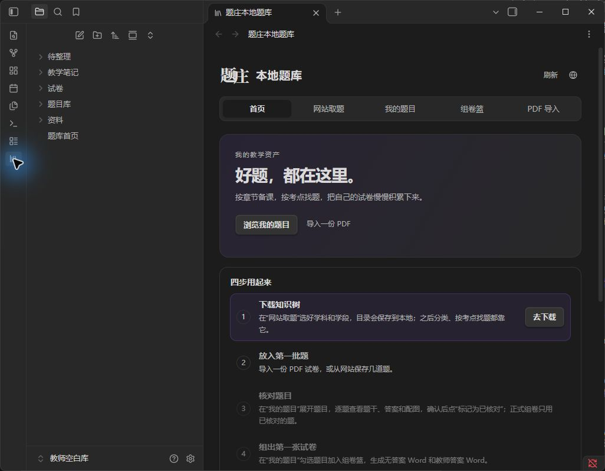
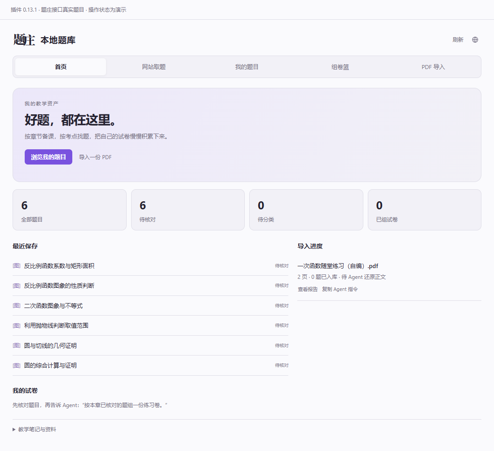
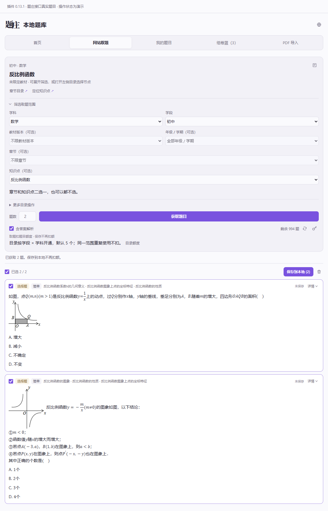
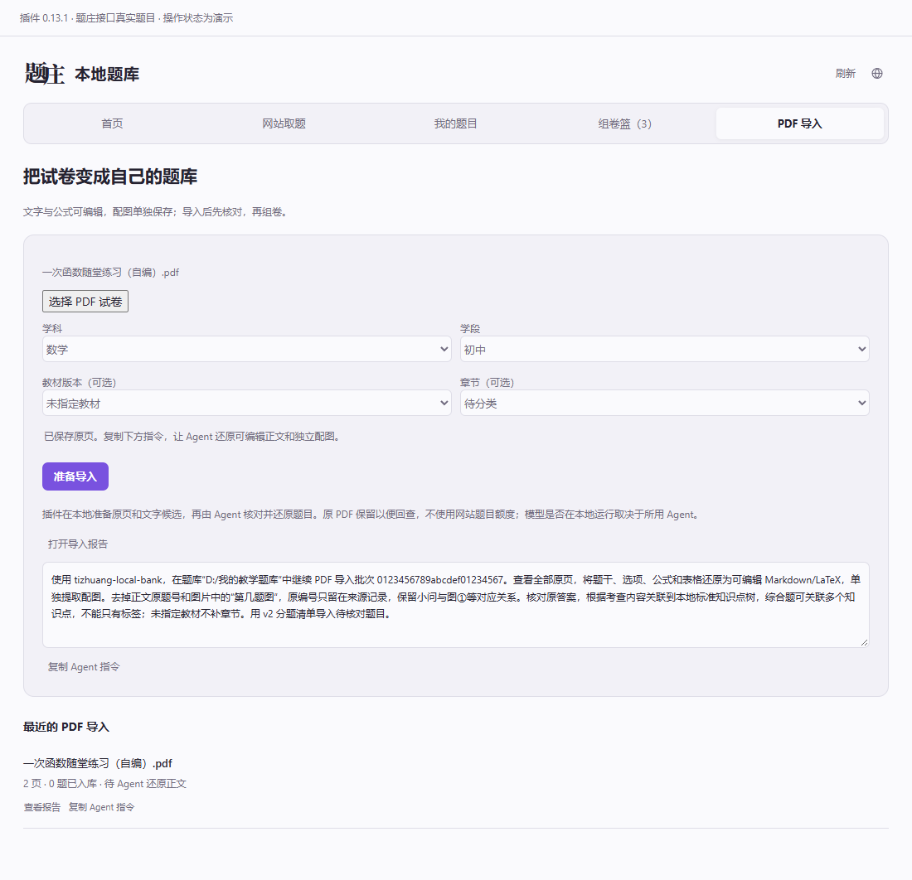
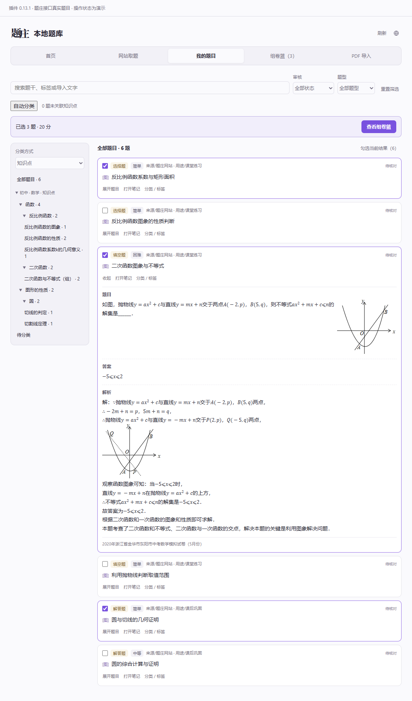
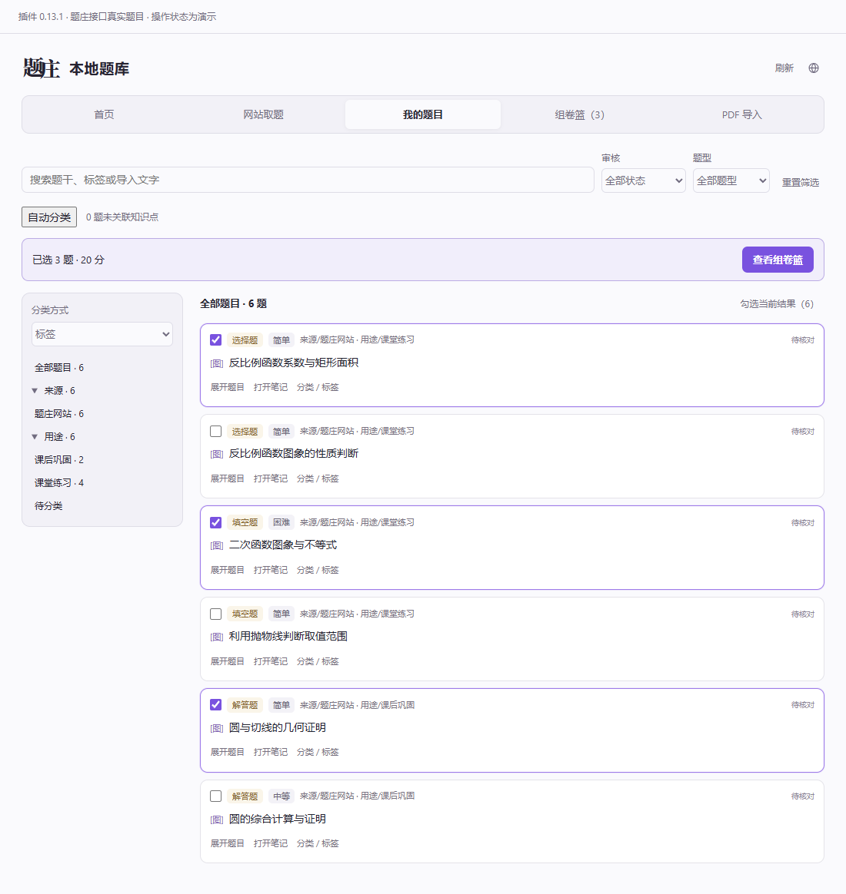
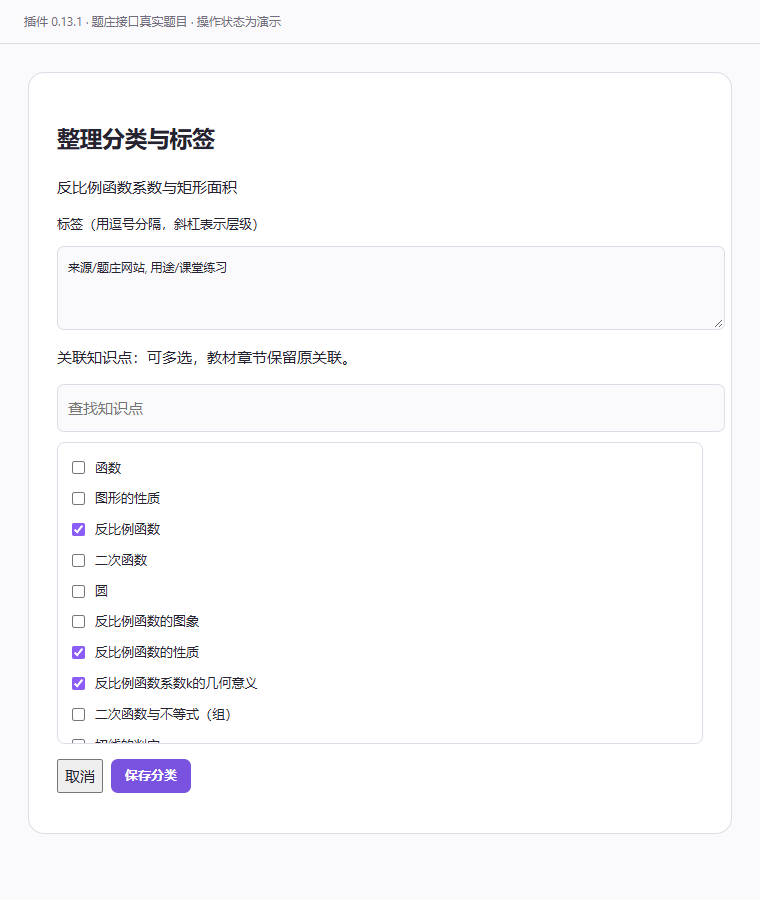
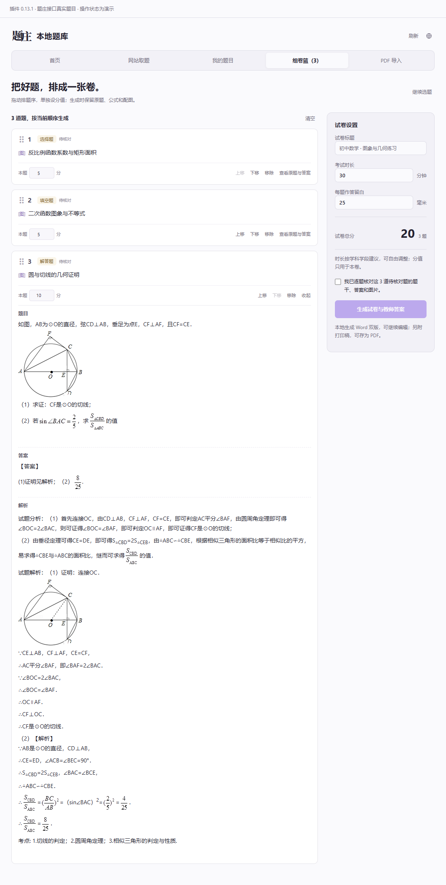
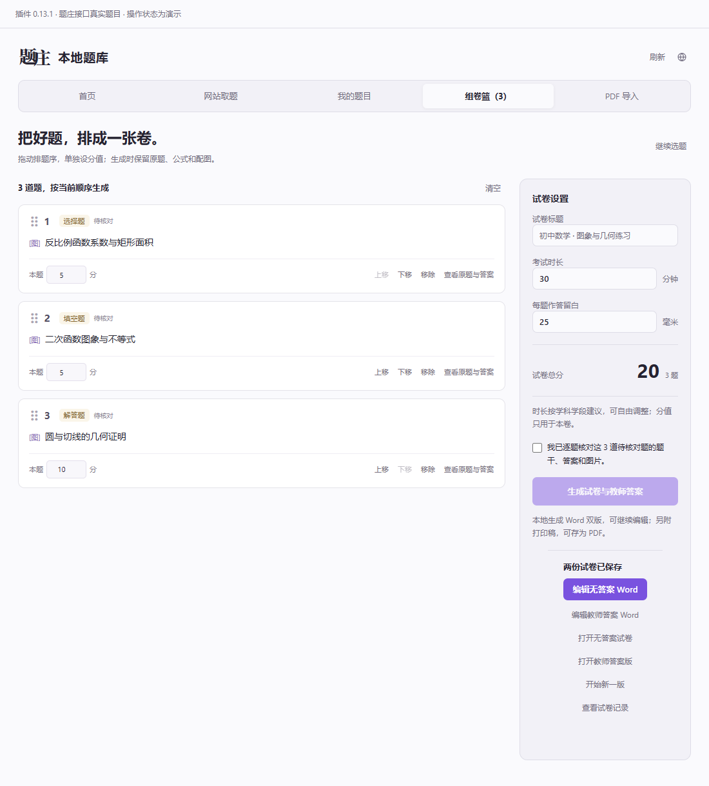

# 题庄本地题库 · 老师使用说明

把网站题目、自己的 PDF 试卷整理到同一个本地题库，再按知识点找题、勾选组卷，输出可以继续编辑的 Word。

**第一次使用：让 Agent 安装并体检 → 下载知识树 → 放入几道题 → 核对 → 组卷。** 已经装好的老师直接从第 3 节开始。

适用版本：起步包 / 新 skill **2.5.1**，Obsidian 插件 **0.14.1**。新增四步引导、环境检查、列表核对与目录自动补齐。

> 图中使用题庄接口实际获取的初中数学题，保留原题干、选项、公式和配图；标题与标签按演示用途整理。截图由插件 0.13.1 的真实界面组件离线渲染，PDF 任务和组卷完成状态用于演示流程。额度以自己账号的实时显示为准。账号 Key 不出图，空白题库不预装这些示例题。

## 目录

- [1. 拿到文件包，先安装](#install)
- [2. 在 Obsidian 中打开](#open)
- [3. 从网站获取题目](#website)
- [4. 导入自己的 PDF 试卷](#pdf)
- [5. 用知识点、章节和标签找题](#classify)
- [6. 勾选组卷，导出 Word](#paper)
- [7. 直接让 Agent 帮你做](#agent)
- [8. 更新、备份与常见问题](#help)

<a id="install"></a>
## 1. 拿到文件包，先安装

你需要一台电脑、Obsidian，以及能访问本地文件和运行工具的 Agent。PDF 识别还需要 Agent 能查看 PDF 原页或图片。单纯的网页聊天窗口不一定能直接操作你电脑上的题库。

### 推荐：把安装交给 Agent

1. 下载完整起步包并解压。如果已经拿到包，直接使用这个解压文件夹。
2. 把解压文件夹的位置告诉 Agent，复制下面这段话。
3. 等它报告安装结果，记住它返回的**实际题库路径**。之后始终使用这个路径。

```text
请阅读这个解压包里的 skills/tizhuang-local-bank/references/install.md，
帮我安装题庄本地题库。检查当前 Agent、已有题库、新 skill 和插件；
没装就安装，旧版就更新，同版或较新版本就跳过。
保留我的题目、图片、试卷和配置，旧 question-bank skill 不动。
完成后运行 doctor.py 体检，通过后告诉我题库的实际路径，以及还需要我在 Obsidian 中做什么。
```

**已有题库的人**在最后加一句“我的题库位于：……”并填真实路径。不要另外创建一个空白库把自己绕晕，也不要把临时解压文件夹当长期题库。

**还没有下载包**，可以直接把这段话交给 Agent：

```text
请按 https://raw.githubusercontent.com/weishao2/tizhuang-agent-skills/main/docs/local-bank/INSTALL.md
帮我安装题庄本地题库。缺少就安装，旧版更新，同版或较新版本跳过；
保留我的题目和配置，旧 question-bank skill 不动。完成后告诉我题库路径。
```

Agent 会处理程序文件和所需的独立 Python 环境。安装结束后，新开一次 Agent 会话，让它识别新 skill。尚未安装 Obsidian 时，使用 [Obsidian 官方下载](https://obsidian.md/download)。

### 文件包里是什么

| 文件 / 文件夹 | 你需要做什么 |
| --- | --- |
| `先看这里.html` | 双击，用浏览器离线阅读这份图文说明 |
| `使用说明.md`、`使用说明图片` | 同一份说明的 Markdown 版本及配图 |
| `题庄本地题库` | 空白模板；安装器会据此配置你的实际题库 |
| `skills/tizhuang-local-bank` | 新 skill，供 Agent 使用 |
| `安装本地环境.ps1` | 手动安装入口，通常交给 Agent 处理即可 |

旧 `question-bank`、新 `tizhuang-local-bank` 和 Obsidian 插件可以独立安装。新工具不用调用旧 skill 才能工作。

<a id="open"></a>
## 2. 在 Obsidian 中打开

1. 打开 Obsidian。在初次欢迎页选择 **“打开本地仓库 / 打开文件夹作为仓库”**；已打开其他仓库时，从左下角仓库菜单进入**管理仓库**。
2. 选择 Agent 刚返回的题库文件夹，例如 `D:\我的教学题库`。选的是题库本身，不是上一级解压目录，也不是 `skills`。
3. 进入 **设置 → 第三方插件**，按提示关闭受限模式，再启用已安装的 **“题庄本地题库”**。无需在社区插件市场另找同名插件。
4. 按 `Ctrl+P`（Mac 用 `Command+P`），搜索 **“打开本地题库”** 并运行。以后也可点击左侧工具栏的题库图标。

Obsidian 不同版本的菜单译名可能略有区别。上述仓库打开和插件启用方式可对照 [官方仓库说明](https://obsidian.md/help/manage-vaults) 与 [官方第三方插件说明](https://obsidian.md/help/community-plugins)。

**看到“全部题目 0”就是空白库正常打开了。** 首页介绍区下方的“四步用起来”会带你继续：

1. 下载知识树：选学科和学段，保存供分类和检索使用的目录。
2. 放入第一批题：网站取题或导入 PDF。
3. 核对题目：逐题检查后标记为已核对。
4. 组出第一张试卷：调整顺序、分值，输出双版 Word。



这张为 0.14.0 首次安装时的真实 Obsidian 截图；0.14.1 保留相同引导。其他八张为真实插件组件的流程演示截图。已经下载目录、有题目、至少核对一道题且生成过试卷时，引导会自动隐藏；不代表题库里的每道题都核对过。

如果遇到环境问题，到 **设置 → 题庄本地题库 → 检查环境**。安装器通常已经配置好 Python，无需日常手填。遇到缺依赖，可把检查结果交给 Agent 修复后再体检。




图 1：首页演示。日常主要使用顶部五个入口，不必展开所有素材文件夹。

| 入口 | 用来做什么 |
| --- | --- |
| 首页 | 看题目数量、待核对、待分类、导入进度和已组试卷 |
| 网站取题 | 选取题范围，把网站题目保存到本地 |
| 我的题目 | 搜索、分类、查看题目、勾选加入组卷篮 |
| 组卷篮 | 调顺序、分值和版面，生成试卷 |
| PDF 导入 | 准备原页，复制指令交给 Agent 识别 |

<a id="website"></a>
## 3. 从网站获取题目

### 第一次先设置自己的凭证

打开 **网站取题**，点击额度旁的**钥匙图标**（“设置自己的凭证”）。在插件设置里填写自己的 **题庄 API Key**，点击 **保存凭证**，返回取题页后刷新额度。

凭证使用你自己题庄账号的 API Key；获取入口以 [题庄官网账号页](https://tizhuang.qcscience.cc/) 当前界面为准。插件不会自动读取旧 skill 的凭证。不要把 Key 写到题目笔记或公开截图里。

### 选范围 → 取题 → 保存

1. 在 **筛选取题范围** 中选学科、学段，例如“数学、初中”。
2. 按需要选择教材版本、年级 / 学期。**章节与知识点二选一，也可以都不选。** 选章节时要先选对应的教材版本；不确定教材时可以只选知识点。
3. 设置题数（每次 1–20 题）。需要教师参考答案时勾选 **含答案解析**。
4. 点击 **获取题目**，查看并确认扣额提示。
5. 预览结果。勾选想保留的题，点 **保存到本地**。随后到 **我的题目** 查看。



图 2：本例按“反比例函数”取题，教材和章节留空。真实题目包含函数图象、公式和选项；示例余额为取题后的查询结果。

选好学科学段后，知识树会同时写入内部数据和左侧 **资料 → 知识目录 → 初中 · 数学**；选教材后，章节写入 **资料 → 教材目录**。目录内容是层级和节点名称，下载目录不会自动下载题目。

如果旧版显示“下载完成”但左侧是空的，更新到 0.14.1 并重新打开本地题库首页，会从已有快照离线补齐，保留已有笔记，不扣额。

已经有本地章节 / 知识点目录时，也可以打开左侧对应节点，再使用 **从当前章节或知识点获取题目**。取题区域的 **章节目录 / 知识点目录** 可打开或定位目录。上次的选择会保留。

**费用发生在获取网站题目时。** 同一批结果保存到本地不再扣题目额度；本地检索、分类和组卷也不扣网站题目额度。目录额度另算：新插件按“学段 × 学科”开通，默认 5 个范围，同一范围重复使用不重复开通，实际余额以账号显示为准。

如果获取题目超时，先刷新额度并检查已恢复的结果，再决定是否重新获取。不要因为还没看到结果就连续点击。

<a id="pdf"></a>
## 4. 导入自己的 PDF 试卷

PDF 导入分成两步：**插件准备材料，Agent 识别入库。** 点击“准备导入”不代表题目已经全部识别完成。

1. 进入 **PDF 导入 → 选择 PDF 试卷**，选你电脑上的文件。第一次建议用一份页数少、字迹清楚的试卷测试。
2. 选学科、学段。教材版本与章节可以留空；只分知识点时不用硬选教材。
3. 点 **准备导入**，等待出现“已保存原页”。
4. 点 **复制 Agent 指令**，把整段发给你安装了新 skill 的 Agent。里面已经带有题库路径和导入批次，不要手动换成另一个题库。
5. 等 Agent 完成入库，返回插件点右上角 **刷新**，在 **我的题目** 中筛选 **待核对**。



图 3：看到复制指令区域后，继续在 Agent 中完成识别。示例文件名与路径仅作演示。

Agent 按原页还原可编辑的题干、选项、公式与表格，单独保留几何图等配图；正文去掉原试卷的大题号，图中的“第几题图”也去掉，原编号留在来源记录中。小问编号及必要的图形对应关系会保留。无法确定的文字或答案需要标记出来，不应猜成确定内容。

如果试卷附有原答案，按原答案录入；没有原答案就保持缺失。PDF 导入后会尝试关联本地知识点，无法确定的再交给 Agent 判断；没有指定教材时，不猜章节。

### 核对以后再正式使用

打开题目，核对**题干、公式、选项、配图、原答案和分类**。确认后，在 **我的题目** 点 **标记为已核对**，或点 **核对本页显示的待核对题（N）** 并确认。批量操作只处理当前显示的题，屏幕外的题不会一起变成已核对。也可以把你实际核对过的题明确告诉 Agent，让它更新状态。

原 PDF 保留在本地，便于回查。不要删除题目正文里的区块标记。扫描件质量差时，先核对识别结果；不需要为赶进度把整道题截图当成最终正文。

PDF 文件在本地准备，不消耗网站题目额度；识别可能消耗你使用的 Agent / 模型额度。模型是否本地运行、原页是否发送给模型，取决于你的 Agent 配置。

<a id="classify"></a>
## 5. 用知识点、章节和标签找题

进入 **我的题目**。左侧 **分类方式** 可以切换三个视角，顶部还能按文字、审核状态和题型筛选。

| 分类方式 | 推荐怎么用 |
| --- | --- |
| 知识点 | 跨教材复习、找同一考点的题；一道综合题可关联多个知识点 |
| 教材章节 | 按自己实际使用的教材版本和章节备课 |
| 标签 | 自己定义教学用途，例如 `用途/课堂例题`、`用途/课后练习` |

**建议先按知识点整理，再用标签表达教学用途。** 教材确定后再补章节。同一道题可以从多个入口找到，正文仍然只有一份。



图 4：左侧选知识点，右侧勾题并展开查看原图、答案与解析；已选题目会跨分类保留在组卷篮里。



图 5：切换为“标签”，用“课堂例题 / 课后练习”等自己的习惯来找题。

### 手动调整一题

点题目卡片的 **分类 / 标签**，填写标签并勾选知识点，点 **保存分类**。多个标签用逗号分隔，斜杠表示层级；知识点可以多选。



图 6：手动分类不会替你改动原来的教材章节。

### 批量自动分类

在 **我的题目** 点 **自动分类 → 分类所有未关联题目**。系统先用已有考点标签匹配本地知识树；不确定的会显示“待 Agent 判断”。点 **复制 Agent 分类指令**，交给 Agent 继续，完成后刷新并查看分类报告。

**自动分类不是把每道题都猜一个类别。** 没有本地知识树时，让 Agent 执行第 7 节的知识树指令，下载对应学科、学段的目录，再刷新插件。网站取题页的 **知识点目录** 用来打开已下载的目录；提示“本地尚未下载”时，也按这个方法处理。已有知识点的题不会被这个批量入口强行重分；需要调整时手动修改或明确让 Agent 处理指定题目。

<a id="paper"></a>
## 6. 勾选组卷，导出 Word

1. 在 **我的题目** 勾选题目左侧的方框；这些勾选就是加入组卷篮。
2. 点击 **查看组卷篮**，或顶部 **组卷篮**。
3. 拖动每道题左侧的点阵手柄，或用 **上移 / 下移** 调顺序；在“本题”后改分值。
4. 填写试卷标题、考试时长和每题作答留白，检查总分。这里的分值只用于本卷。
5. 如果包含待核对题，先点 **查看原题与答案** 逐题核对，再勾选确认。没有核对过就先返回处理。
6. 点 **生成试卷与教师答案**，等待保存完成。



图 7：本例选了 3 道网站真实题，总分 20 分。它们仍是待核对状态，必须由老师核对后再确认生成；题库中的原题保留。

生成后会出现这些入口：



图 8：生成完成后的按钮区演示。点击对应按钮打开文件，不需要自己在素材文件夹里找。

| 按钮 | 打开什么 |
| --- | --- |
| 编辑无答案 Word | 给学生使用的 `.docx`，可用 Word / WPS 继续调整 |
| 编辑教师答案 Word | 带已有答案、解析的教师版 `.docx` |
| 打开无答案试卷 | HTML 打印稿，在浏览器打印或另存为 PDF |
| 打开教师答案版 | 教师版 HTML 打印稿 |
| 查看试卷记录 | 回到本次组卷的记录和输出链接 |

Word 中的文字和转换成功的公式可以编辑，配图仍是图片。**在 Word 里修改不会自动回写题库原题。** 如果还要调整题库中的题干，回到题目笔记修改。教师版只包含题库里已有的答案、解析，缺失答案不会凭空补齐。

需要重新组一版时，保留已手工编辑的 Word，再回到组卷篮调整或点击 **开始新一版**。不要把旧的 Word 编辑结果误认为已经同步到下一版。

<a id="agent"></a>
## 7. 直接让 Agent 帮你做

把下面指令中的 `D:\我的教学题库` 换成你的实际题库路径。Agent 与插件读写同一个题库；导入、改题或生成试卷时，让一个操作先完成，再开始另一个。

### 下载知识点树

```text
使用 tizhuang-local-bank，为题库“D:\我的教学题库”下载初中数学知识点树。
解析网站实际的学科、学段和节点编号，不猜编号。
这次只下载目录，不获取网站题目，不选择教材。
完成后告诉我在插件哪里查看，以及是否已有可归类的本地题目。
```

知识树提供分类层级和编号，本身不包含题目。空白库只有目录、没有题是正常现象。

### 直接导入 PDF

```text
使用 tizhuang-local-bank，把我提供的 PDF 导入“D:\我的教学题库”。
逐页查看原页，提取可编辑的文字、公式和选项，单独保存配图。
去掉正文原题号和图片中的“第几题图”，保留小问和必要的图形引用。
只录入原答案；缺失或识别不清的内容标记待核对。
按本地知识点树分类，综合题可关联多个节点；教材暂不选。
导入后全部保持待核对，告诉我数量、导入报告和需要人工检查的地方。
```

已经在插件“准备导入”过的 PDF，优先使用插件生成的批次指令，接着原批次做。

### 整理旧题

```text
使用 tizhuang-local-bank，检查“D:\我的教学题库”中未关联知识点的题目。
阅读题干和配图，按本地知识树的真实节点分类，综合题允许多个知识点。
先验证分类清单再应用。保留正文、答案、分值和审核状态，教材章节先不动。
不能确定的列出来，不强行归类。
```

### 从本地题库组卷

```text
使用 tizhuang-local-bank，只使用“D:\我的教学题库”里已核对的初中数学题。
找 10 道一次函数题，基础题在前，每题 5 分，标题“一次函数巩固练习”，时长 30 分钟。
保持题干、选项和答案原样，生成无答案 Word 和教师答案 Word，并附打印稿。
数量不足或现有信息不能判断难度时直接告诉我，不编题，也不自动从网站扣额取题。
完成后给我两份 Word 和试卷记录的路径。
```

如果只想先看看候选题，把“生成……”改成“先列出候选题让我挑选”。Agent 可直接生成本地试卷，不要求先在可视化组卷篮里勾题。

<a id="help"></a>
## 8. 更新、备份与常见问题

### 更新怎么做

把原题库路径与第 1 节的安装指令发给 Agent 即可。安装器检查版本：旧版更新，同版完整或更高版本跳过，已有用户不必再使用空白模板。它只处理新工具的程序文件，保留原来的题目、配置和旧 skill。

更新后重载插件或重新打开 Obsidian；新 skill 更新后新开 Agent 会话。本说明对应 **skill 2.4.3 / 插件 0.13.1**，这两个版本号不同是正常的。

### 题库里的文件夹要不要整理

平时从插件首页进入即可。`题目库` 放题目，`试卷` 放输出，`教学笔记` 放自己的备课记录，`待整理` 放处理中任务，`资料` 集中放原 PDF、配图和知识目录。

`资料` 里的图片和原件仍会被题目引用，不要因为侧栏里不常打开就删除。备份时复制**整个题库文件夹**，包括隐藏的 `.bank`、`.obsidian`；不要只备份 `.md` 题目文件。更换电脑后让 Agent 重新检查依赖环境和凭证是否可用。

### 遇到问题先看这里

| 现象 | 怎么处理 |
| --- | --- |
| 安装完没有题目 | 起步包就是空白库。先网站取题并保存，或导入自己的 PDF |
| 看不到插件入口 | 确认打开的是实际题库，设置里启用了“题庄本地题库”；重开后用命令面板搜索“打开本地题库” |
| 只能看到 Markdown，没看到工作台 | 用命令面板打开插件工作台，不必停留在某个普通笔记页 |
| PDF 已准备，但“我的题目”没有新题 | 复制 Agent 指令继续识别入库，完成后刷新；查看导入报告里的状态 |
| 自动分类后仍有待分类题 | 查看报告并把待判断指令交给 Agent；确认本地有对应学科、学段的知识树 |
| 选某个教材时看不到导入题 | 未指定教材的题不会强行归进该教材；切到知识点、标签或全部题目查看 |
| 网站取题失败或额度异常 | 先刷新额度、核对凭证和结果缓存，把错误信息提供给 Agent；不要连续重复扣额取题 |
| PDF / Word 提示 Python 或依赖错误 | 把报错和题库路径交给安装 Agent，让它检查本工具的独立环境；不要随意覆盖原 Python 配置 |
| 组卷提示公式转换失败 | 保留错误信息，定位出错的题与公式；让 Agent 修正对应题目后重试 |
| 某个历史打印稿打开为空 | 从组卷记录或“打开无答案试卷”按钮打开真实 HTML；仍异常时把记录路径交给 Agent 检查，不要先删原文件 |

需要反馈时，提供**插件版本、实际点击步骤、报错文字**和局部截图即可，遮住 API Key。第一次成功导入并核对几道题后，再批量整理整套资料。

在线入口：[题庄本地题库](https://github.com/weishao2/tizhuang-agent-skills/tree/main/docs/local-bank) · [Agent 安装说明](https://github.com/weishao2/tizhuang-agent-skills/blob/main/docs/local-bank/INSTALL.md)
