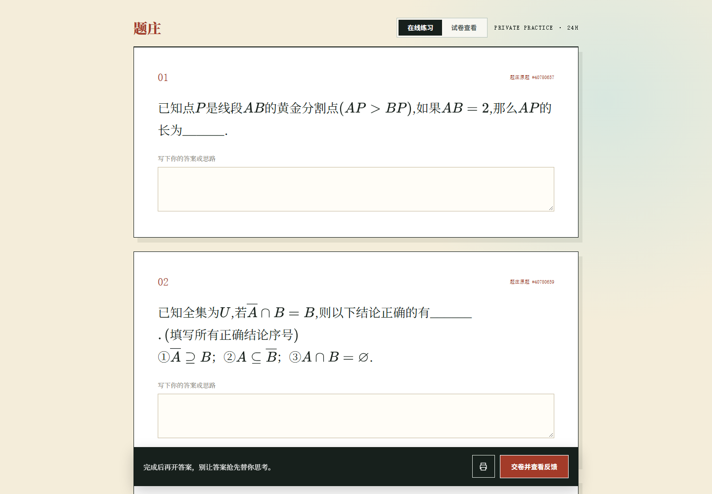
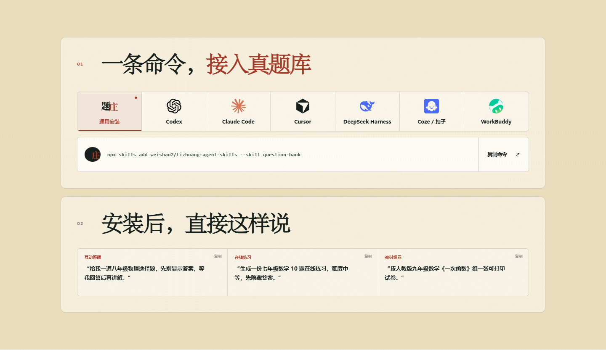

# 题庄在线题库

版本 **1.0.3** · 更新于 **2026-10-18** · [更新记录](CHANGELOG.md)

**把备课要求说清楚，让 Agent 帮你找到合适的真题。**

按学科、学段、教材、章节、知识点与难度筛选，保留原题、公式、配图和答案解析；需要整理成卷时，在网站继续编辑。

[返回题庄技能目录](../../README.md) · [官网详情](https://tizhuang.qcscience.cc/skills/question-bank) · [在线组卷](https://tizhuang.qcscience.cc/builder)

## 看看实际效果



*实际网站截图：数学题干与公式。截图展示题目内容，不代表当前账户额度。*

适合三类任务：

- 单元复习：按教材章节组织练习。
- 专题训练：按知识点、题型和难度筛选。
- 课堂测验：明确题量与组卷要求，到网站继续编辑卷面。

## 三步开始

1. 在支持 Skill 的 Agent 中安装 `question-bank`。
2. 可以先用游客额度体验；需要账户额度或保存试卷时，再按指引配置自己的 Key。
3. 先试一个知识点，再组织整张试卷。

可以直接把这段话发给 Agent：

> 请读取 https://tizhuang.qcscience.cc/api/agent-install.md，帮我安装题庄在线题库 question-bank，检查连接，并告诉我如何开始找题。

也可以使用原有安装命令：

```bash
npx skills add weishao2/tizhuang-agent-skills --skill question-bank
```

Codex、Claude Code、Cursor、DeepSeek Harness、插件市场等安装方法见 [各客户端安装方式](客户端安装.md)。既有 Skill 名称和安装契约保持不变。



*既有官网真实截图：支持的接入方式。新版官网将安装说明集中到本产品详情页。*

## 试着这样说

```text
用 question-bank 找人教版八年级数学一次函数的 10 道中等难度真题，保留配图和解析，再帮我整理组卷要求。
```

```text
用 question-bank 准备一份六年级数学单元复习卷，20 道题，基础和中等难度为主。先确认教材和章节，再取题。
```

## MCP 接入

不安装 Skill 也可使用支持远程 MCP 的客户端：

- 地址：`https://tizhuang.qcscience.cc/mcp`
- 传输：Streamable HTTP
- 请求头：`X-API-Key`，填入你自己的 Key。
- [官网 MCP 配置说明](https://tizhuang.qcscience.cc/skills/question-bank#mcp)

## 费用与边界

普通用户基础功能免费，网站取题使用自己的账号额度，实际额度在账户页查看。第三方 Agent 和模型可能另行收费。

在线题库不要求安装 Obsidian 或本地题库 Skill。题量取决于实际范围；没有符合条件的题应明确说明，调整条件后再取题。正式使用试卷前由老师检查题干、答案和配图。
