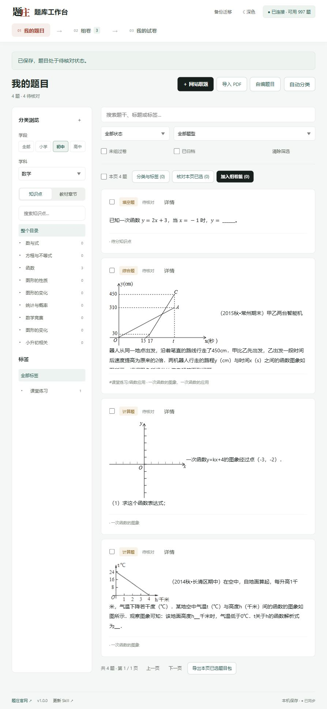

# 题庄 · 题库工作台

**找来的题、手头的 PDF、组好的试卷，留在自己的电脑里。**

版本 **1.0.0** · 2026-11-08。无需 Obsidian；页面与 Agent 使用同一份题库和组卷篮。工作台是题庄新的主推本地技能，旧 Obsidian 版保留历史下载，不再做功能更新，也不会被自动覆盖。

## 开始使用

下载完整包，交给能操作本机文件的 Agent：

> 请按 tizhuang-studio 的 SKILL.md 安装题库工作台，自动检查环境。未装则安装，旧版更新，同版跳过，保留我的题目和配置。打开工作台；旧 Skill 和 Obsidian 题库不要动。

程序与题库分开放置。Agent 会创建独立 Python 环境并运行体检。打开本机页面后，在右上角“连接题庄”输入自己的 API Key。不要把 Key 发到聊天或放进安装包。

[详细安装与更新](references/install.md) · [Agent 题库操作](references/library-workflow.md) · [PDF 分题](references/pdf-workflow.md) · [MCP 接入](references/mcp-workflow.md)



[老师使用说明](references/user-guide.md) · [更新记录](CHANGELOG.md)

## 日常只有三个步骤

| 我的题目 | 组卷 | 我的试卷 |
|---|---|---|
| 网站取题、PDF 导入、自编题；按知识点、教材章节或标签查找；编辑与核对 | 勾选题目、换顺序、改分值、设置标题与时长 | 搜索历史稿、改名/标签、预览、打印、下载 Word，继续编辑另存新稿 |

点击左上角 Logo 回到“概览”，查看题量、待核对、导入进度和新手引导。右上角为连接状态、主题、备份迁移。深色模式下题目保持白底。

## 可以直接交给 Agent

- “从我保存的题里挑 5 道一次函数题，优先没组过卷的，加入当前组卷篮。”
- “第二题放到第一题，改为 8 分，卷名改为一次函数课堂小测。”
- “继续这个 PDF 批次，按原页恢复文字、公式和独立配图，不要整题截图，不猜答案。”
- “按已下载的知识树给未分类题分类，暂时不要选教材。”
- “给这个工作区做完整备份，检查能不能恢复。”

Agent 先读当前 state/revision，再通过工作台服务修改；不会另建第二个组卷篮。已配置题庄 MCP 的客户端可使用 OAuth 或 API Key 取题再入库，页面直接取题仍用 API Key。

## 导出的试卷

- 无答案 Word 和教师答案 Word 两份，文字及 LaTeX/MathML 转换后的公式可编辑。
- 按题型分组，自动列出每组题数与总分；同题型保留选定顺序。
- HTML 预览与打印共用布局。Word 由独立文档排版引擎输出，分页可能与浏览器不同。
- 每次生成保存快照，之后改组卷篮不会改掉历史稿。继续编辑后生成新稿。

## 数据和核对

题目、图片、目录、PDF 和历史试卷保存在所选工作区，不随浏览器关闭而删除。换电脑请使用“备份迁移”，本版不提供自动云同步。

PDF 上传只准备原页，之后由能看图的 Agent 分题。题干、原答案和配图需老师核对后才能正式出卷。原稿没有答案就留空说明，不由 AI 冒充原答案。原题本身是图片的公式仍保留为图片，不承诺全部可编辑。

网站取题按账户额度，已保存的题反复组卷不再扣取题额度。知识点与教材章节使用账户已开通的学科学段目录；同范围重复下载不新增名额。

## 开发验证

```text
python -m unittest discover -s tests -v
node --test tests/*.cjs
```

安装器、测试目录和示例程序中不包含用户题库、会话或 Key。更新只管理本技能程序文件，保留整个数据工作区。
