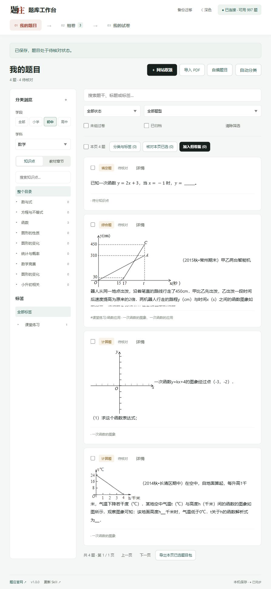
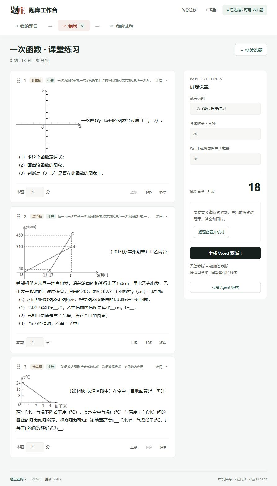

# 题库工作台使用说明

适用版本：1.0.0。网站取题要连接题庄；已保存题目的检索、组卷和备份在本机完成。

## 1. 安装与启动

把官方完整 ZIP 交给能操作本机文件的 Agent，请它按 [安装说明](install.md) 执行安装和体检。首次需要选择一个独立题库目录；之后始终沿用这个目录。

安装器自动创建独立 Python 环境。同内容跳过，更新前备份程序，不覆盖用户题库、未知文件或两个旧 Skill。Windows 可用 `scripts/start.ps1 -Workspace <题库绝对路径>` 启动；它优先复用已运行的工作台。

首次题库为空是正常的，不附带老师的题目、Key 或演示数据。

## 2. 连接与目录

右上角“连接题庄”输入自己的 API Key。连接成功后显示剩余额度；Key 不会写入题库，服务重启后需要重新输入。不要公开 Key，也不要放在安装脚本和聊天中。

在“我的题目”左侧下载目录，先选学段和学科。知识点树不依赖教材；教材章节需要选择具体版本。目录下载使用账户已开通的学科学段名额，同范围再次下载不新增名额。已有目录优先从本机加载。

## 3. 三种添加题目方式

- **网站取题**：选择学段、学科，再按知识点或教材章节筛选，两者互斥，也可以都不指定具体节点。填写题数，获取后自动保存在本机。勾选需要的题加入组卷篮。
- **导入 PDF**：选择 PDF 和学科学段，准备原页。点击“交给 Agent 分题”，把指令交给能看图的 Agent。Agent 对照每一页，恢复文字、LaTeX、选项、原答案和独立配图，保存为待核对。准备原页不代表分题完成。
- **自编题目**：填写题干、答案和解析，支持 Markdown + LaTeX；明确标明自编，不冒充网站原题。教学笔记只用于备课，不进入试卷。

PDF 原稿没有答案，就标明缺少原答案，不让 AI 猜成原答案。不默认选择教材；可以先分知识点。独立配图保留数学标注和水印，去掉外层题号与“第几题图”说明。

## 4. 分类、搜索、核对

左侧按学段学科展开知识树或章节树，可以搜索目录节点；标签支持“课堂练习/函数应用”等层级。同一道题能关联多个知识点。搜索框搜索题干、标题和标签，不访问网站，也不扣取题额度。

“自动分类”只按真实目录中唯一同名节点匹配。不确定的题留给 Agent 读题判断，或手动分类。编辑正文后会重新变为待核对。

老师展开题目，对照题干、答案、公式和配图，确认后点击“标记为已核对”。批量核对只针对本页勾选题；不要未看题就整库确认。Agent 不替老师执行核对。

## 5. 组卷与 Agent 协同

勾选题目加入组卷篮。通过上下移动或拖动调整题序，输入分值，填写卷名和时长。Word 解答题留白按需要调整。

也可以告诉 Agent：

> 使用 tizhuang-studio，读取当前工作区和 revision，把第二题移到第一题，设为 8 分，标题改为“一次函数课堂小测”，时长 20 分钟。

Agent 通过同一工作台服务写入，页面自动同步；它不会另建第二份篮子。已配置题庄 MCP 时，Agent 可通过 OAuth 或 API Key 取题再保存到此工作区；页面自己取题使用 API Key。

## 6. Word、预览与历史试卷

待核对题全部经老师确认后，生成 Word 双版：学生卷不含答案，教师版包含原答案与解析。按题型分组，自动计算每组题数与分值，同题型内保持所选顺序。

“我的试卷”提供搜索、直接改名、标签、预览和打印菜单，以及继续编辑。列表改名只用于区分历史稿，不改已经下载的 Word；要改卷头，继续编辑并重新生成，原稿保留。

HTML 预览与浏览器打印共用布局；Word 分页由文档软件处理，可能不同。文字和可转换的公式可编辑，上游图片公式仍是图片。复杂合并表格等无法可靠导出的内容会报错，应先检查而非跳过。

## 7. 备份、迁移、关闭与更新

右上角“备份迁移”创建完整备份，包含题目、图片、PDF、目录、组卷篮、历史试卷及编辑历史，不含 Key 和本机会话。下载 ZIP 并存到可靠位置。

只分享部分题时，勾选后导出题目包。导入包会跳过已有同号题，不覆盖当前篮子；新导入题需核对。支持工作台与旧本地题库的 v1 题目包，不能直接把任意 Obsidian 仓库当作完整备份导入。

恢复完整备份会替换目标工作区，并先保存恢复前备份。让 Agent 恢复时明确目标路径，不把备份误恢复到另一份题库。

关掉页面后题目仍在；下次启动同一工作区继续。换电脑使用备份，本版没有自动云同步。更新时再执行安装指令，体检通过后重开服务并重新连接 Key。

## 8. 常见问题

| 现象 | 处理 |
|---|---|
| 安装失败或页面打不开 | 让 Agent 运行 doctor，按具体缺失依赖修复，重新启动同一工作区。不要删除题库。 |
| 目录只显示一个范围 | 检查已下载目录和账户已开通范围，必要时下载对应知识树；教材和知识树是两个分类维度。 |
| PDF 没有新题 | 原页准备后还需 Agent 识别分题，最后老师核对。 |
| 网站取题报错 | 检查 Key、额度、筛选范围，先看现有结果与记录；不要连续重复取题。 |
| Word 导出失败 | 检查未核对、缺失原答案、损坏图片、公式或复杂表格，按报错修复。 |
| 找不到几个月前的题 | 确认启动的是原工作区；查看原题库目录或备份，不另建空目录冒充恢复。 |

截图来自 2026-11-08 独立录像题库：网站真题与明确标注的自编示例。包内不附这些题目。录屏和线上发布状态以交付清单为准。
